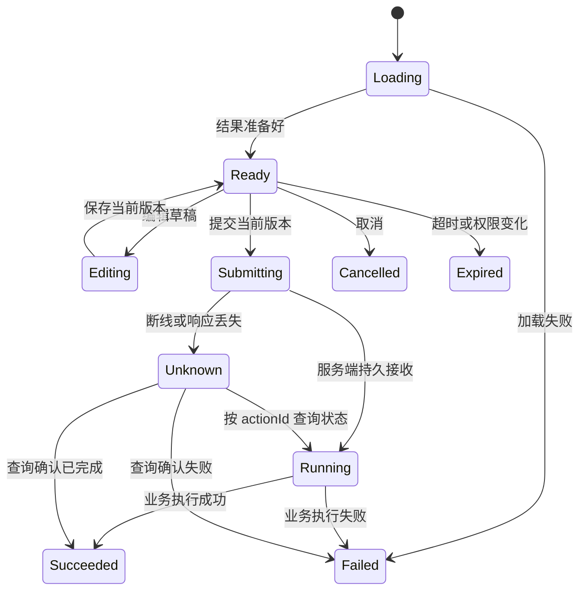

# 聊天 Agent 交互卡片方案

日期：2026-10-27。状态：设计提案，尚未实现卡片协议、操作接口或 UI。适用 Web、桌面和 Android。

## 目标与当前基础

采用对话助手常见的“正文回答 + 结构化结果 + 明确操作”形式，保留轻聊现有橙色纸感视觉。
卡片承载可查看、可选择、可确认的业务对象；普通回答继续使用文本，不把每句话包成卡片。
不展示模型内部思维链；执行进度只展示实际发生的检索、工具调用与业务操作。

已存在的基础，以源码为准：

- 后端 `chat-room/src/main/proto/agent_stream.proto` 已支持文本、工具调用、工具结果、用量、完成和错误事件。
- Web `web/src/services/agentStreamReducer.ts` 目前把工具事件拼入文本，没有独立卡片状态；不能靠解析已经拼接的文本恢复可靠交互。
- 原生 `src/commonMain/kotlin/core/ProtobufMessageDispatcher.kt` 已分发工具与流式事件；`component/chat/MessageBubble.kt` 是展示入口。
- 后端已有工具注册、用户身份和执行约束。卡片操作仍需经过这些边界，不新增允许客户端任意执行工具的入口。

## 首批卡片

| 类型 | 内容 | 用户可做的事 | 首期范围 |
| --- | --- | --- | --- |
| 检索结果 | 摘要、会话名、命中时间、少量消息片段 | 打开原会话、定位消息、展开更多 | 第一批 |
| 联系人/群组 | 昵称、头像、公开资料、关系状态 | 查看资料、打开聊天、选择对象 | 第一批 |
| 待发送消息 | 目标、正文、附件、回复引用 | 编辑、确认发送、取消 | 第二批 |
| 澄清选择 | 有歧义的目标或时间范围、最多五个候选 | 单选、补充说明、取消 | 第二批 |
| 文件结果 | 文件名、类型、大小、生成状态 | 预览、下载、复制链接 | 第三批 |
| 执行回执 | 成功/部分成功/失败、实际完成项 | 查看结果、重试失败项 | 与有副作用卡片一起上线 |

支付、扣费、批量删除、批量邀请不纳入首批。检索无结果显示空状态和修改条件入口，不生成虚假的来源卡。

## 对话中的布局

```text
Agent   找到了 3 条相关约定，下面这条最接近。

┌ 聊天记录 · 3 个结果 ──────────────────┐
│ 与小林 · 10 月 25 日 14:32             │
│ “周五前把第一版发到群里……”             │
│ [打开原消息]                 [展开其余] │
└───────────────────────────────────────┘

Agent   要把下面这段发给小林吗？
┌ 待发送 · 私聊：小林 ───────────────────┐
│ 第一版已经整理好了，请查收。             │
│ [编辑正文]              [取消] [确认发送]│
└───────────────────────────────────────┘
```

- 一条 Agent 回复可含多个按顺序排列的内容块：正文、来源列表、业务卡片、执行回执。
- 卡片最大宽度 640px，移动端占可用宽度；320px 下按钮换行，正文和链接不横向溢出。
- 标题 14–16px、正文 14px、辅助信息 12px；使用现有主题变量，不硬编码另一套浅色主题。
- 每张卡最多一个主操作、两个次操作，其余进入菜单；主操作写明动作，如“发送给小林”。
- 长内容默认摘要加展开，不自动抢占焦点；流式更新保留折叠状态与编辑草稿。
- 新内容自动滚动沿用现有“用户在底部才贴底”规则。图片/折叠高度变化交给虚拟列表更新测量。
- 键盘可完成选择、编辑、确认与取消；状态变化使用低频 `aria-live`，避免逐 token 播报。

## 状态与交互

卡片状态与整个回答的流式状态分别维护：回答生成结束不代表卡片操作执行完成。



- **只读操作**：资料、展开、定位消息可直接响应；服务端重新检查查看权限。
- **写操作**：展示完整预览后确认。模型生成卡片不构成用户授权；只有显式点击确认才能进入执行。
- **修改预览**：产生新 revision，旧确认按钮立即失效。不能确认旧正文而执行新正文。
- **重复点击/丢 ACK**：同一 actionId 与幂等键查询/重试，不能换 ID 再执行一次。
- **取消**：执行前可取消；执行后只取消等待，不宣称已撤销成功操作。需要撤回时提供独立业务动作。
- **切换会话/账号**：捕获 accountId、conversationId、requestId；过期异步结果不能更新新账号的卡片。
- **多设备**：操作状态由服务端裁决。另一设备完成后，旧 revision 的操作返回最新状态，不重复执行。
- **过期**：建议可执行预览默认 15 分钟，配置可调整。重开生成新预览和 actionId，重新确认。

## 数据契约：类型化内容块与受控动作

以下是拟议的应用模型示例，不是现有接口。显示字段与可执行参数分开，客户端只提交服务端签发的操作标识。

```json
{
  "cardId": "card_...",
  "requestId": "12003",
  "conversationId": "agent:42",
  "revision": 3,
  "kind": "message_preview",
  "state": "ready",
  "expiresAt": "2026-10-27T12:15:00Z",
  "preview": {
    "recipient": {"id": "17", "name": "小林"},
    "text": "第一版已经整理好了，请查收。"
  },
  "actions": [{"actionId": "act_...", "kind": "confirm_send", "label": "发送给小林"}]
}
```

- `kind` 和内容使用明确的联合类型/Protobuf oneof。每种卡片单独验证必填字段，避免所有业务装入 `Map<String,Object>`。
- 使用稳定 cardId、actionId、requestId；64 位数字 ID 在线路和 Web 中保持十进制字符串精度。
- 后端保存真实接收者、正文、附件和权限范围；显示名称不参与执行寻址。
- `actions` 来自服务端业务适配器白名单。模型提供业务建议，经校验后由服务端构造卡片；不接受模型直接生成的 URL、脚本或工具调用名作为操作。
- `preview` 保存脱敏后的必要信息；原始工具参数、token、完整检索上下文不放入卡片。
- 编辑采用对应类型的修改对象，例如 `MessagePreviewEdit`；服务端校验、保存后返回新 revision。

## 协议和接口演进计划

1. 在 `AgentStreamType` **追加**卡片创建/更新事件，不修改已发布编号；在 `AgentStreamChunk.payload` 追加明确的 CardEvent。
2. CardEvent 携带完整的当前卡片快照和 revision，首期不做 JSON Patch。客户端仅应用更大 revision；重复事件无副作用。
3. 文本事件继续只包含正文。卡片快照独立持久化，重启不依赖解析工具日志；历史读取返回正文块顺序和卡片最终状态。
4. 拟议 REST：`GET /agent/cards/{cardId}` 查询最新状态；`PATCH /agent/cards/{cardId}/preview` 修改预览；`POST /agent/cards/{cardId}/actions/{actionId}` 执行；取消使用明确的取消动作。
5. 所有请求从认证上下文取账号，检查卡片归属与会话权限。执行提交携带 `expectedRevision` 和稳定 `idempotencyKey`。
6. 服务端事务/条件更新裁决 Ready → Running，并持久化 action 记录；需要外部 IO 时由可恢复任务执行，不能用一次内存异步事件代替可靠执行。
7. 执行记录与聊天发送共享稳定业务请求 ID。消息服务端持久接收和接收端送达分开显示，不把本地写入视为发送成功。
8. 状态通知经过现有账号 owner 网关，再投递同网关多设备；不向所有网关广播。
9. 此方案不要求保留旧客户端专用卡片兼容分支；按同一版本的三端协议统一发布。端能力未知/协议不匹配时显式报告版本错误，不执行动作。

完整修改时检查后端主 proto、Kotlin 两处副本、Web source/public 副本及各端生成流程。本轮文档不修改 schema。

## 推荐组织

| 层 | 建议职责 |
| --- | --- |
| 后端 CardService 门面 | 创建、授权、编辑、过期与执行编排 |
| CardActionHandler 注册表 | 按明确动作类型注册处理器，检查重复注册；不要按每种状态再建一个类 |
| 卡片与动作存储 | revision 条件更新、幂等请求、执行状态、恢复与审计；Redis 只做加速 |
| 工具结果适配器 | 将业务查询结果变为类型化预览，过滤内部字段 |
| Web CardRenderer 注册表 | kind → Vue 组件；组件发出操作意图，service 提交/查询，store 合并 revision |
| Kotlin sealed CardContent | Compose 按类型渲染，共享状态和操作客户端，平台只负责导航/文件预览 |

必需内部组件使用明确依赖注入，启动失败就暴露配置问题；不增加“Bean 不存在就省略授权/审计/幂等”的降级路径。

## 安全、容量与失败体验

- XSS：文本正常转义，富文本沿用净化；不渲染任意 HTML/iframe。链接只允许受控 scheme，跳转目标由业务路由生成。
- 权限：来源卡片不泄漏被屏蔽、已退群或越权会话；点开时二次授权，失效来源显示“已不可访问”。
- 操作授权与过期均在服务端判断，客户端禁用按钮仅是体验提示。
- 默认建议每次回复最多 10 卡，每卡 20 条预览、标题 80 字、摘要 1000 字，序列化单卡上限 24KiB；超出分页加载。
- 卡片事件发出前检查完整编码包不超过当前 64KiB 实时帧限制，不把附件字节或大型工具 JSON 塞入卡片。
- 附件沿用统一上传：每用户每日 100 张未复用图片、普通文件 20MiB；预览时展示额度失败，避免确认后才发现附件尚未上传。
- 工具真实结果失败显示失败和可操作建议，不把模型推测内容标成已完成。自动重试只用于明确幂等动作。
- 未知执行结果展示“正在确认结果”，按 actionId 查询；服务端恢复任务处理卡住的 Running，客户端刷新不能重置状态。
- 指标只记录 kind、动作类型、延迟、拒绝原因和成功率，避免把正文、用户 ID、cardId 放进高基数指标标签。

## 分阶段落地与验收

**第一阶段：只读卡片。** 完成类型与协议、独立 reducer/持久化、三端渲染、检索和资料卡。验收乱序/重复事件、历史恢复、空结果、权限撤销、暗色/三语言/320px、键盘和大列表滚动。

**第二阶段：确认式操作。** 加入预览编辑、澄清选择、动作持久化和幂等执行。验收双击、双设备同时确认、编辑与确认竞争、过期、断线丢响应、进程重启、部分失败。用虚构联系人和测试消息，不连真实账号自动发送。

**第三阶段：文件与任务。** 加入文件预览/下载和长任务状态。验收附件额度、文件失效、后台任务恢复、取消边界与用户可理解的失败提示。

建议首个纵向闭环选“检索聊天记录 → 展示来源卡 → 打开原消息”；随后实现“生成待发正文 → 编辑 → 确认 → 持久接收回执”。不同时重写整个 Agent 页面。
