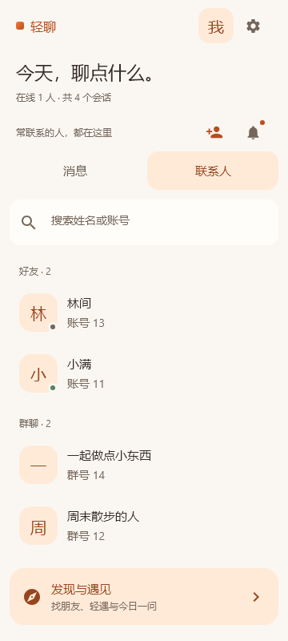

# 消息与联系人标签

实施日期：2026-10-26。覆盖 Kotlin 共享客户端（桌面、Android）和独立 Vue Web。

## 行为

- 侧栏提供“消息 / 联系人”两个标签。选中标签用杏色底与深橙文字，深色模式改为棕色底与浅橙文字。
- 消息页保留已有的活动时间、未读排序和摘要；本轮没有改成“只有聊过天的人才出现”的会话模型。
- 联系人页分为好友、群聊，按名字排序，显示签名或账号/群号，不展示聊天摘要与未读数。排除当前账号和 AI 助手，AI 仍在消息页。
- 两页各自保存搜索词。联系人支持姓名、账号 ID、群号搜索；Web 兼容额外的 account 字段。
- 切换标签不选择聊天、不清未读；点击联系人进入聊天。手机返回列表、Web 跨过桌面/手机断点时保留标签和搜索词。登出后不保留这些搜索条件。
- 保留发现、好友申请、设置入口；空目录与搜索无结果分别提供发现或清空搜索操作。新增文案覆盖中文、英文、日文。
- Web 标签支持方向键、Home / End、焦点与选中语义；原生标签使用 Compose Tab 语义和至少 48 dp 点击区域。

## 实现入口

| 层 | 文件 |
| --- | --- |
| 原生目录规则 | `src/commonMain/kotlin/component/user/ContactDirectory.kt` |
| 原生列表、标签、分组 | `component/user/UserListScreen.kt`、`PaperConversationUi.kt` |
| 原生导航状态与群聊分发 | `component/chat/ChatApp.kt`、`ContactChatScreen.kt` |
| Web 目录规则 | `web/src/utils/contactDirectory.ts` |
| Web 列表与受控导航状态 | `web/src/components/SidebarUsers.vue`、`web/src/views/WebApp.vue` |
| Web 群名与发送目标 | `web/src/components/ChatWindow.vue` |

表中 `component/` 相对 `src/commonMain/kotlin/`。Web 合并已有 friends 与 groups 状态用于展示，没有新增后端接口。

接入群聊时修复了两处旧路径：原生负数群条目此前被传给私聊页面，现在进入 `GroupChatScreen`；Web 列表使用负数 ID，但群消息正文、重试、附件的协议目标与本地 groupId 必须为正数。协议定义没有修改。原生动画键也区分列表与群号 1，避免共用 `-1`。

## 验证

在 `CharRoom` 下：

```powershell
./scripts/gradle-windows.ps1 -GradleArguments @('-I','scripts/paper-preview.gradle','renderPaperPreview',':test','--tests','component.user.ContactDirectoryTest','--tests','component.chat.ComposerInteractionTest',':androidApp:assembleDebug','-PquicJniLibsDir=../native/quiche-jni/jniLibs','--no-daemon','--console=plain')
```

在 `CharRoom/web` 下：

```text
npm test
npm run build
node tests/contacts-browser.cjs <Chromium executable>
```

- **通过**：JVM 编译、Android Debug 构建（复用已有 JNI 库）、2 项目录测试与 3 项输入框回归。
- **通过**：8 个离线 Compose 场景渲染；检查联系人浅/深色与 320 dp、130% 字号。
- **通过**：Web 类型检查、30 项单元测试、生产构建。
- **通过**：Web 浏览器夹具验证键盘切换、未读保留、姓名与搜索空态、手机返回、私聊/群聊入口、实际编码的正数群目标、三语言、浅深色 320 px 布局及选中态配色。
- **未运行**：Android 安装和真机操作、CLI 运行、真实后端双账号收发/ACK。浏览器使用隔离虚构账号，拦截所有外部 HTTP 请求并替换 WebTransport；Compose 预览没有创建业务 ViewModel 或联网。
- 构建保留已有 Gradle/Vite 弃用、依赖打包警告。构建产生的无关站点日期和 OG 图片变化不纳入本次改动。

## 预览

原生截图为真实共享组件的离线渲染，Web 截图来自构建后的应用与虚构数据。



[原生深色](images/contacts-native-dark.png) · [Web 桌面](images/contacts-web-desktop.png) · [Web 深色窄屏](images/contacts-web-dark.png)
