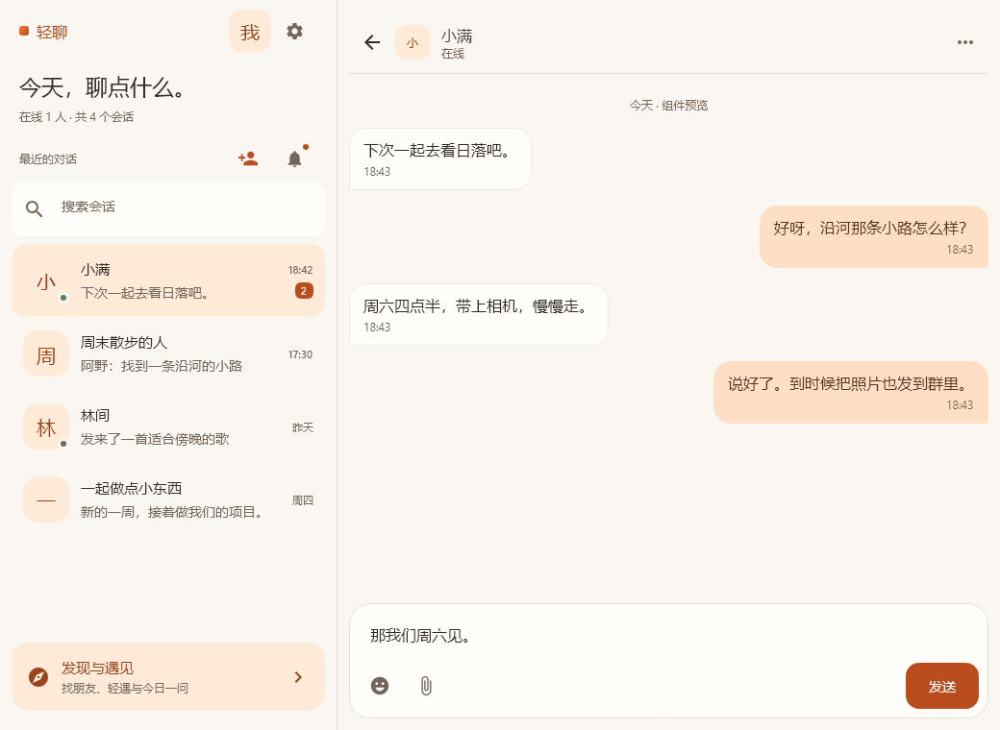

# 轻聊 · 橙色纸感设计

后续增量：[消息与联系人标签](CONTACTS-TAB.md)（2026-10-26，原生与 Web，包含最新验证记录）。

2026-10-27 Web 已对齐共享色板，并完成首页、登录、联系人、聊天和发现的统一设计，见 [Web 产品设计](WEB-PAPER-PRODUCT.md)。下文为首轮原生实施记录。

2026-10-25。采用已选定的「纸感社交」方向，保留橙色品牌。首轮覆盖共享主题、会话列表、私聊/群聊气泡与输入区、资料卡封面；Web 尚未同步。



[深色聊天组件预览](images/orange-paper-dark.png)。图片通过 Compose 离线渲染，使用虚构数据；这是共享组件拼装预览，并非登录后的完整页面截图。

## 颜色有各自的职责

| 用途 | 浅色 | 深色 | 使用方式 |
| --- | --- | --- | --- |
| 纸色背景 | `#FAF7F2` | `#211D1A` | 页面底色，避免长时间面对高饱和橙色 |
| 内容表面 | `#FFFDF9` | `#2D2722` | 输入区、收到的消息 |
| 正文墨色 | `#342B25` | `#F4EAE0` | 标题、主要内容 |
| 次要文字 | `#75665B` | `#C2B2A4` | 摘要、时间、辅助说明 |
| 品牌亮橙 | `#F47B35` | `#F69250` | 小面积标识、装饰；不用来承载白色小字 |
| 操作橙 | `#B94D1D` | `#FFB17A` | 发送、未读、重要操作；搭配各自的 `onAction` |
| 杏色 | `#FFEAD8` | `#483122` | 选中会话、默认头像、发现入口；搭配 `onApricot` |
| 自己的消息 | `#FFDFC4` | `#573924` | 搭配 `#59341F` / `#FFE5D0`，保证长消息阅读舒适 |

颜色集中在 `component/QingliaoTheme.kt`。桌面与 Android 使用同一个 `QingliaoTheme`，旧 Material 组件仍通过兼容色板取色。语义色是成对的背景/文字，不直接把 `primary` 作为所有容器背景。

## 页面和交互

- 会话列表：品牌标识与个人入口在顶部，问候标题独立排版，搜索、最近会话和底部发现入口分层；保留添加联系人、申请、设置、未读与头像入口。
- 会话行：48 dp 头像、圆角矩形选中态、杏色底；在线状态仍有辅助语义，不把橙色当作在线状态。
- 聊天：减少透明卡片和气泡阴影；自己的消息用杏色加深色字，正文 16 sp / 25 sp 行高。
- 输入区：编辑区与工具行分开，窄屏也保留输入宽度；表情、附件和发送具有独立操作区域。沿用中文输入法候选确认、Enter 发送和组合键换行策略。
- 动效：按压缩放收敛到 0.97；新消息使用较短位移和无回弹动画，历史消息保持静态。
- 名片：淡杏色封面、暖色头像和清晰姓名；保持现有编辑、关系和隐私逻辑。

这是首轮共享组件落地。拖动调整桌面栏宽、完整的手机手势、发现页整体重排和 Web 对齐另行实施。

## 离线检查

预览直接渲染共享 Compose 组件，使用虚构人物和消息，不创建 ViewModel，不初始化传输，不连接后端。

Windows 在 `CharRoom` 下执行：

```powershell
./scripts/gradle-windows.ps1 -GradleArguments @('-I', 'scripts/paper-preview.gradle', 'renderPaperPreview', '--no-daemon')
./scripts/gradle-windows.ps1 test --tests component.chat.ComposerInteractionTest --no-daemon
```

其他平台可用 `./gradlew -I scripts/paper-preview.gradle renderPaperPreview`。输出在 `build/ui-preview/`，覆盖桌面、浅色列表、浅/深色聊天、320 dp 与 130% 字号。预览脚本只在显式加载 init script 时加入测试源集，不进入正常应用包。

预览是组件验收材料，不能代替 Android 真机键盘、系统栏、长列表滚动和真实收发联调。Android 构建按 [客户端约定](../../AGENTS.md) 和 [原生 QUIC 指南](../../native/README.md) 执行。

## 本轮验证记录

- **通过**：JVM `compileKotlin`；离线 Compose 渲染 5 个场景；检查桌面、深色聊天和窄屏大字号预览。
- **通过**：`component.chat.ComposerInteractionTest` 共 3 项，覆盖输入法候选确认、空输入/修饰键和 Enter 提交。
- **通过**：`:androidApp:assembleDebug`，复用已有 QUIC JNI 库（`-PquicJniLibsDir=../native/quiche-jni/jniLibs`，相对于 Android 模块）；现有 Gradle 弃用警告仍存在。
- **未运行**：Android 安装/真机回归、登录后完整页面与真实收发联调、CLI 运行、Web 检查。没有修改协议或后端，没有推送或发布。
- 主要文字配色静态对比度：浅色发送按钮约 5.07:1，浅色消息正文约 8.58:1；深色分别约 7.96:1、8.62:1。该数值针对不透明色对，不代表所有历史组件都已完成无障碍审查。
