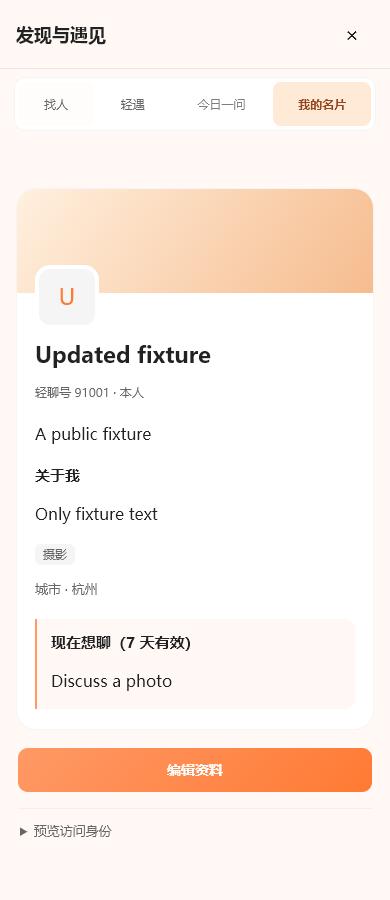

# 手机 Web：发现与遇见

2026-10-26。范围为 Vue Web，包括 Android 手机浏览器；本轮未修改 Kotlin 原生客户端。

## 交互调整

- 弹层跟随当前可见屏幕的高度和偏移，覆盖键盘、浏览器工具栏和旋转造成的变化；保留安全区。头部与导航固定在弹层内，发现内容和资料详情分别滚动，取消外层重复滚动。
- 移除轻遇页强制 560 px 最小高度，保留消息历史自身的滚动区。短屏下其他操作仍可通过内容区滚动到达。
- 我的名片只展示封面、头像、姓名、签名、简介、兴趣和聊天意向；名片内没有按钮、选择器或表单。移除“我的名片”上方多余的返回按钮，保留弹层关闭和栏目导航。
- 编辑、发消息、加好友位于卡片下方独立操作区；身份预览、举报和屏蔽使用次级展开区域。申请待处理禁用、好友关系、权限预览、提交防重和接口调用保持原有逻辑。
- 编辑时展示独立表单，聚焦第一个字段；保存或取消后返回名片顶部。取消不会保存草稿。其他人的资料保留返回入口与触发按钮的焦点恢复。
- 找人页先展示搜索与人物，渠道和兴趣筛选默认收起，存在条件时显示数量；筛选值仍随搜索请求提交。
- 暖橙封面、杏色导航选中态、浅深色配色与至少 44 px 的主要点击区域，延续现有橙色方向。

## 代码与验证

### 四个入口的加载一致性

- 找人、轻遇、今日一问、我的名片统一先准备数据，再一次性切换页面与导航选中态；等待期间保留当前内容，在固定高度的提示区说明目标。首次打开使用中性准备页，不展示假的空列表或空闲匹配状态。
- 资料详情同样准备完成再打开。我的名片并行读取资料和屏蔽列表，将结果直接交给组件，避免进入后再次从空白加载；轻遇直接使用新取到的房间状态，之后继续轮询。
- 连续点击取消旧请求，旧响应不能覆盖新选择。失败保留原页面，12 秒超时给出重试；重试成功后恢复弹层内焦点。
- 找人（按搜索条件区分）与今日一问使用 20 秒内存快照，最多 8 项，命中读取不延长有效期。关闭弹层、切换账号和本地资料/关系/回答修改后清除；资料详情、隐私信息和轻遇入口始终重新读取。
- 后续后端已补充 20 秒 Redis 候选 ID 缓存，范围为找人和今日一问；命中仍读取最新内容与权限。轻遇、基础用户资料沿用后端已有 Redis。详见相邻 `chat-room/docs/development/SOCIAL-DISCOVERY.md`。尚未测量真实后端延迟，前端加载时序与服务端缓存分别解决页面跳变和重复查询。

### 检查记录

主要文件位于 `web/src/`：`components/SocialHub.vue`、`SocialProfileCard.vue`、`composables/useVisualViewport.ts`、`useDialog.ts`、`styles/social.css`，以及三份语言文件。

可见屏幕测量使用 [MDN VisualViewport 文档](https://developer.mozilla.org/en-US/docs/Web/API/VisualViewport) 描述的高度、偏移与 resize/scroll 事件；无该接口时回退到窗口尺寸。事件与动画帧在卸载时清理。

在 `CharRoom/web` 中执行：

```text
npm test
npm run build
node tests/social-browser.cjs <Chromium executable>
node tests/contacts-browser.cjs <Chromium executable>
```

- **通过**：类型检查、生产构建、30 项单元测试。
- **通过**：双账号社交浏览器回归，包括编辑/取消、隐私预览、好友申请、发消息、举报、屏蔽/解除，以及轻遇准备、重试、交换、延长、退出、今日一问。
- **通过**：650 ms 延迟下保留当前页面、20 秒内重复进入不重复读取、取消待进入页面、入口失败后重试、按服务端排队状态进入轻遇，以及重试成功后的弹层焦点恢复。
- **通过**：模拟 410 px / 370 px 可见高度与顶部偏移；长资料加载后的内部滚动；名片无交互控件；320 / 390 / 1000 px 浅深色布局；联系人标签回归。
- **未运行**：真实 Android 设备键盘和厂商浏览器实测、真实后端双账号收发。浏览器夹具拦截外部 HTTP 并替换 WebTransport，不使用线上账号。
- 现有构建依赖与打包警告未在本轮处理。没有修改协议或后端。

## 预览

截图来自真实 Web 构建与虚构资料。



[深色窄屏预览](images/social-mobile-dark.png)
